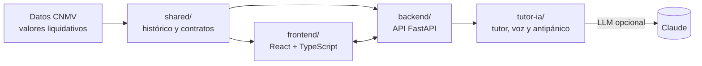

# Tech2Finance

**Entender primero, invertir después.**

Copiloto de inversión con IA, de marca blanca, para la sección de inversión de un banco. Acompaña al cliente antes, durante y después de invertir: adapta la interfaz a lo que sabe, le explica su cartera por texto y voz, y le ayuda a mantener la calma cuando el mercado cae.

> Entorno de demostración educativo: no usa dinero, cuentas ni operaciones reales y no constituye asesoramiento financiero.

---

## El problema

- **Se invierte sin entender.** Muchos clientes contratan fondos desde la app de su banco sin conocer su riesgo, sus costes ni el horizonte necesario.
- **Pánico en las caídas.** Cuando el mercado baja, el cliente no sabe si es normal y vende en el peor momento: una pérdida temporal se vuelve definitiva.
- **El test MiFID como trámite.** Se rellena para "aprobar", no para entender.

Para el banco esto supone reembolsos por pánico, pérdida de patrimonio gestionado, reclamaciones y clientes desconfiados, y el asesoramiento humano no escala a todos los clientes.

## La solución

| Funcionalidad | Qué hace |
| --- | --- |
| **Interfaz por niveles** | Básico, Intermedio y Avanzado, en tema claro y oscuro: de explicaciones sencillas a métricas profesionales (volatilidad, máxima caída, Sharpe, mapa de rentabilidad mensual). |
| **Agente de IA (texto y voz, ES/EN)** | Explica la pantalla ("¿Qué estoy viendo?") y la situación de la cartera frente al objetivo ("¿Cómo van las cosas?"). |
| **Pausa antipánico** | Ante una caída, muestra qué ha pasado y su contexto antes de vender, **sin bloquear la decisión** ni prometer recuperación. |
| **Educación y Test MiFID** | Contenido por niveles y práctica del test de conveniencia con explicaciones de cada pregunta. |
| **Simulador** | Recorrido guiado con fondos reales y "¿Y si vendo?", que compara mantener con vender en un mes concreto, más escenarios ilustrativos. |
| **Mi cartera** | Posiciones, rentabilidad, riesgo y evolución de una cartera de ejemplo. |
| **Modo presentación** | Recorrido guiado de 7 pasos por todo el producto (`?demo=1`). |

## Valor diferencial

- **Acompaña en el momento del miedo.** Las apps bancarias y los neobrókers muestran datos y permiten operar; los robo-advisors deciden por el cliente. Tech2Finance **explica** para que el cliente decida mejor.
- **Se adapta al cliente**: una interfaz que crece con su conocimiento.
- **Datos reales y cifras fiables**: históricos oficiales de la CNMV; las métricas las calcula el código y la IA solo las explica.
- **Prudente a nivel regulatorio**: información educativa, sin órdenes ni recomendaciones personalizadas.

### Qué aporta al banco

- **Retención de patrimonio**: menos reembolsos por pánico.
- **Cumplimiento**: clientes que entienden lo que contratan y menos reclamaciones.
- **Escala**: acompañamiento personalizado sin un asesor por cliente.
- **Modelo de negocio**: licencia SaaS por banco más tarifa por usuario activo. El banco es el cliente comercial y su usuario utiliza la herramienta. Esta hipótesis está pendiente de validar; ver la [investigación de viabilidad](docs/investigacion/2026-11-10-viabilidad/informe.md).

## Uso de IA

- **Modelos de lenguaje (Claude)** para explicar la cartera y analizar caídas con fuentes de contexto.
- **Asistente de voz bilingüe** que mejora la accesibilidad y la interactividad.
- **Garantías**: las cifras se calculan por código y un filtro del backend rechaza textos con números inventados. Sin servidor ni clave de IA, la app usa un tutor local por reglas, de modo que la demo siempre funciona.

## Arquitectura



| Área | Carpetas |
| --- | --- |
| Interfaz y experiencia | [frontend](frontend/) |
| Backend e integración | [backend](backend/) |
| Simulador y motor | [simulador](simulador/) |
| IA, voz y antipánico | [tutor-ia](tutor-ia/) |
| Datos, pruebas y presentación | [datos](datos/), [tests](tests/), [presentacion](presentacion/) |

Más detalle: [contexto del proyecto](docs/contexto-proyecto.md), [contratos](docs/contratos.md), [backend](docs/backend-contexto.md), [organización](docs/organizacion.md), [agentes](docs/agentes.md) y [plan](docs/planning/plan.md).

## Requisitos

- Node.js 20 o superior y npm
- Python 3.11 o superior
- Git

## Instalación

```bash
git clone https://github.com/JaimeMoscardoS/tech2finance.git
cd tech2finance

# Frontend y tutor
npm install

# Backend
cd backend
python -m venv .venv
# Windows:      .venv\Scripts\activate
# macOS/Linux:  source .venv/bin/activate
pip install -r requirements.txt
cd ..
```

## Configuración (opcional)

La demo funciona sin configuración. Para activar la IA real, copia `.env.example` a `.env` y añade tu clave del proveedor de IA. **No subas nunca claves al repositorio.**

## Ejecución

```bash
npm run dev:full
```

Arranca el frontend y el backend a la vez. Abre **http://localhost:5173**.

- **Modo presentación**: http://localhost:5173/?demo=1
- **Ver de nuevo la bienvenida**: borra el `localStorage` del navegador.

## Pruebas

```bash
npm test                 # pruebas unitarias (frontend y tutor)
cd backend && pytest     # pruebas del backend
npx playwright test      # pruebas end-to-end
```

## Datos

- **Reales**: valores liquidativos mensuales de cinco fondos publicados por la [CNMV](https://www.cnmv.es/portal/publicaciones/descarga-informacion-individual.aspx), con 73 cierres de diciembre de 2019 a diciembre de 2025. Se usa la última observación de cada mes, sin interpolación ni extrapolación. La procedencia está versionada en `shared/nav-history.json` y la reutilización está sujeta a la [nota legal de la CNMV](https://www.cnmv.es/portal/Utilidades/NotaLegal).
- **Ficticios (DEMO)**: las participaciones, los importes y el objetivo de la cartera de ejemplo, y los perfiles de los fondos que no publica la CNMV. Se marcan siempre como DEMO.
- Las simulaciones no son predicciones ni recomendaciones. Los costes desconocidos no se inventan.

## Accesibilidad

Contraste WCAG AA en los 6 temas (3 niveles × claro y oscuro), navegación por teclado, alternativas de texto en las gráficas, asistente por voz, diseño adaptable a móvil y respeto de la preferencia de movimiento reducido.

## Limitaciones

- Prototipo de demostración: sin conexión con bancos reales ni operaciones.
- La cartera del usuario es de ejemplo.
- La IA real requiere clave del proveedor; sin ella se usa el tutor local por reglas.

## Colaborar

Trabaja en una rama propia, abre un pull request y pide revisión antes de integrar. No subas claves ni datos privados.

## Equipo

Marta López, Jaime Moscardó, Ignacio Gil, Manu Carrasco, Diego Pérez
