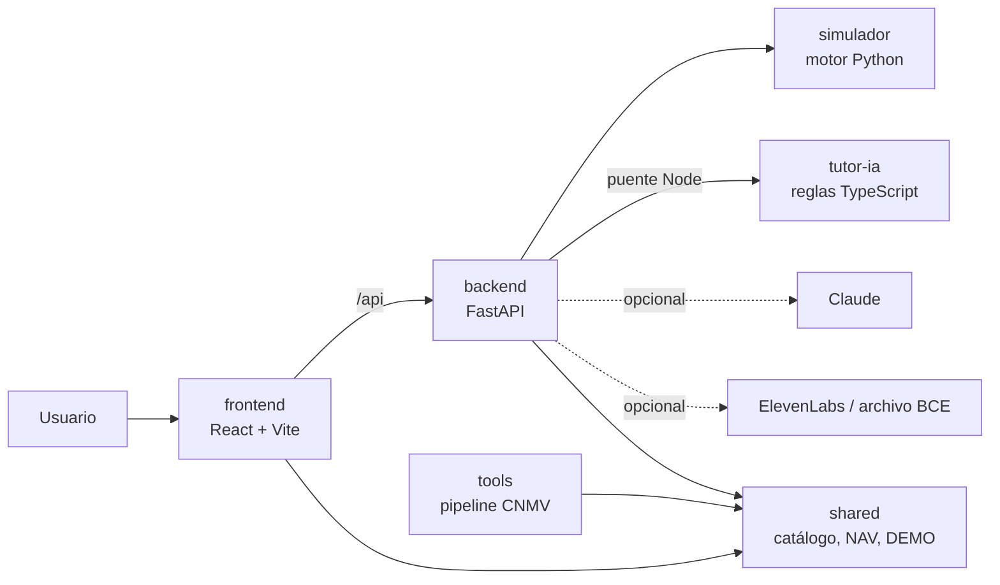

# Tech2Finance

**Entender primero, invertir después.**

Copiloto de inversión con IA de marca blanca para bancos: una capa que la entidad integra en su aplicación para que el cliente comprenda lo que ve, practique con datos históricos y decida con calma.

> **Entorno de demostración educativo.** No hay dinero, cuentas ni operaciones reales, y nada de lo que muestra es asesoramiento financiero. Las simulaciones no predicen ni garantizan rendimientos.

## El problema

- **Se invierte sin entender.** Términos, gráficos y riesgos que el cliente no domina.
- **Ventas por pánico en las caídas.** Quien no sabe interpretar una bajada tiende a vender en el peor momento.
- **El test MiFID es un trámite.** Se rellena para cumplir, no para aprender.

Para el banco, esto se traduce en patrimonio que se marcha tras una caída, clientes que desconfían de la inversión y un cumplimiento normativo que existe sobre el papel pero no genera comprensión.

## La solución

- **Interfaz por niveles**: Básico, Intermedio y Avanzado, en tema claro u oscuro. El nivel cambia la profundidad de la explicación, no el perfil de riesgo.
- **Agente de IA por texto y voz** (español e inglés), que explica conceptos y los datos de la pantalla.
- **Pausa antipánico**: antes de vender muestra el análisis de la caída y recuerda objetivo, horizonte y liquidez. **Nunca bloquea la venta** ni presiona a mantener.
- **Educación y Test MiFID** de práctica, con explicaciones.
- **Simulador** con valores liquidativos reales de la CNMV y el recorrido «¿Y si vendo?», que compara mantener con vender en un mes concreto.
- **Mi cartera** ficticia, calculada con esas mismas series reales.

## Valor diferencial y qué aporta al banco

- **Retención de patrimonio**: menos ventas impulsivas en las caídas.
- **Cumplimiento**: educación y MiFID como experiencia útil, no como formulario.
- **Escala**: un tutor disponible para todos los clientes a la vez, con la marca de la entidad.
- **Modelo propuesto**: SaaS B2B con precio por banco y por usuario activo ([análisis estratégico](docs/analisis-estrategico.md)). Es una hipótesis **sin validar**: no hay precios ni clientes confirmados. Véase la [investigación de viabilidad](docs/investigacion/2026-11-10-viabilidad/informe.md).

## Uso de la IA

- **Modelo**: Claude Sonnet (`claude-sonnet-5-5` por defecto, configurable con `T2F_ANTHROPIC_MODEL`), llamado solo desde el servidor.
- **Qué hace**: redacta las explicaciones del tutor, narra el análisis de una caída y, con ElevenLabs, permite dictar por voz. La lectura de las respuestas usa las voces locales del navegador.
- **Garantías**:
  - Las cifras las calculan el código y reglas verificables; el LLM solo explica.
  - Un filtro rechaza cualquier número que no figure en los hechos aportados (`backend/tutor_bridge.py`).
  - Sin clave ni servicios externos, el tutor funciona con reglas locales. Si un proveedor configurado falla, el endpoint devuelve error en lugar de cambiar de modo en silencio.
  - Las claves permanecen en el servidor, nunca en el navegador ni en Git.

## Arquitectura



| Carpeta | Contenido |
| --- | --- |
| [`frontend/`](frontend/README.md) | Interfaz React, temas, niveles, voz y pruebas Playwright |
| [`backend/`](backend/README.md) | API FastAPI: catálogo, simulaciones, caídas, tutor y voz |
| [`simulador/`](simulador/README.md) | Motor de cálculo en Python |
| [`tutor-ia/`](tutor-ia/README.md) | Tutor por reglas y análisis de caídas (TypeScript) |
| `shared/` | Datos y contratos compartidos: NAV CNMV, catálogo, datos DEMO ([contratos](docs/contratos.md)) |
| [`datos/`](datos/README.md) | Registro de fuentes |
| `tools/` | Lanzador `dev:full` y scripts del pipeline de datos CNMV |
| [`presentacion/`](presentacion/README.md) | Guion de demostración |
| [`tests/`](tests/README.md) | Pruebas integradas |
| [`docs/`](docs/contexto-proyecto.md) | Contexto, organización, contratos y diseño |

## Requisitos

- **Node.js 22.12 o posterior** (`engines` del `package.json`; CI usa Node 24).
- **Python 3.14** (versión usada en CI).
- **Google Chrome**, solo para las pruebas Playwright.

## Instalación

Desde la raíz del repositorio.

**Windows (PowerShell)**

```powershell
git clone https://github.com/JaimeMoscardoS/tech2finance.git
cd tech2finance
py -3.14 -m venv .venv
.\.venv\Scripts\python.exe -m pip install -r backend\requirements.txt
npm --prefix frontend ci
```

**macOS / Linux**

```sh
git clone https://github.com/JaimeMoscardoS/tech2finance.git
cd tech2finance
python3.14 -m venv .venv
.venv/bin/python -m pip install -r backend/requirements.txt
npm --prefix frontend ci
```

## Configuración

Todas las variables son **opcionales**: la demo funciona completa sin ninguna. La aplicación **no lee `.env` automáticamente**; [`.env.example`](.env.example) es una referencia y las variables se exportan en la terminal antes de arrancar. Nunca subas claves reales.

| Variable | Efecto | Sin ella |
| --- | --- | --- |
| `ANTHROPIC_API_KEY` | Activa Claude en el tutor y en el análisis de caídas | Tutor por reglas locales |
| `T2F_ANTHROPIC_MODEL` | Elige el modelo | `claude-sonnet-5-5` |
| `T2F_ANALYSIS_PROVIDER` | `anthropic` narra el análisis de caídas con Claude | `demo` (reglas) |
| `ELEVENLABS_API_KEY` | Dictado por voz mediante el servidor | Reconocimiento local del navegador |
| `T2F_NEWS_PROVIDER` | `off` desactiva el contexto del archivo público del BCE | `ecb_archive` |
| `T2F_BACKEND_PORT`, `T2F_FRONTEND_PORT`, `T2F_PYTHON` | Puertos e intérprete del lanzador | 8000, 5173, `.venv` |
| `VITE_BANK_ID` | Entidad del frontend: `demo`, `caixabank`, `bbva`, `santander` | `demo` |

```powershell
# Windows PowerShell
$env:ANTHROPIC_API_KEY = "<tu-clave>"
```

```sh
# macOS / Linux
export ANTHROPIC_API_KEY="<tu-clave>"
```

## Ejecución

Un solo comando arranca backend y frontend; Ctrl+C detiene ambos:

```sh
npm run dev:full
```

Abre **http://127.0.0.1:5173**. Si un puerto está ocupado, el lanzador falla sin reutilizarlo: define `T2F_BACKEND_PORT` y `T2F_FRONTEND_PORT`. Por separado, en dos terminales:

```sh
# Backend (en Windows: .\.venv\Scripts\python.exe)
.venv/bin/python -m uvicorn backend.app:app --host 127.0.0.1 --port 8000

# Frontend (reenvía /api al backend en el puerto 8000)
cd frontend
npm run dev
```

**Modo presentación**: abre `http://127.0.0.1:5173/?demo=1` para el recorrido guiado de 7 pasos (también con el botón «Presentar»). Guion en [presentacion](presentacion/demo-banco-t2f.md).

## Pruebas

Estado verificado el 11-11-2026 en esta rama:

| Suite | Comando | Resultado |
| --- | --- | --- |
| Frontend + tutor (TypeScript) | `cd frontend && npm test` | 159 pruebas |
| Lanzador | `npm run test:launcher` | 14 pruebas |
| Backend | `python -m pytest backend/tests -q` | 278 pruebas |
| Simulador | `python -m unittest discover -s simulador/tests` | 22 pruebas |
| Extremo a extremo | `cd frontend && npx playwright test` | 217 pruebas |

Playwright arranca solo un backend de prueba (puerto 8111) y varios servidores Vite, y necesita Chrome. Configuraciones adicionales en el [README del frontend](frontend/README.md).

## Datos

- **Reales**: valores liquidativos de cinco fondos publicados por la [CNMV](https://www.cnmv.es/portal/publicaciones/descarga-informacion-individual.aspx), con 73 cierres mensuales (diciembre 2019 a diciembre 2025), sin interpolar ni extrapolar. Procedencia en `shared/nav-history.json`; condiciones en la [nota legal de la CNMV](https://www.cnmv.es/portal/Utilidades/NotaLegal). El pipeline está en `tools/` y las fuentes en el [registro](datos/registro-fuentes.json).
- **DEMO**: la cartera de ejemplo, los escenarios narrativos y los datos de `shared/mock/` son ficticios, llevan etiqueta DEMO y están separados de los datos publicados. [BancoT2F](docs/banco-t2f.md) es una entidad ficticia.
- Las noticias son contexto y no prueban causalidad.

## Accesibilidad y limitaciones

- **Accesibilidad**: colores con contraste WCAG AA en los seis temas (3 niveles × claro/oscuro), navegación por teclado, respeto de `prefers-reduced-motion`, tabla accesible en los gráficos, voz opcional con alternativa escrita y diseño adaptable a móvil. La comprobación con lectores de pantalla reales sigue pendiente.
- **Limitaciones**: sin conexión bancaria, operaciones ni datos de clientes; el rendimiento pasado no garantiza el futuro; el filtro de entidad es de interfaz y no un control de acceso; la detección de preocupación del tutor se basa en palabras; el modelo de negocio y el encaje con bancos están sin validar.

## Más documentación

[Contexto](docs/contexto-proyecto.md) · [Organización](docs/organizacion.md) · [Contratos](docs/contratos.md) · [Agentes](docs/agentes.md) · [Diseño del dashboard](docs/diseno-dashboard.md) · [Backend](docs/backend-contexto.md) · [Simulador histórico](docs/simulador-historico.md) · [Kit de piloto](docs/pilot-kit/alcance.md)

## Equipo y licencia

- Equipo: [Nombre], [Nombre], [Nombre], [Nombre], [Nombre]
- Licencia: [Por definir]. El repositorio no incluye archivo de licencia; el componente CountUp de React Bits conserva la suya en [`frontend/REACT-BITS-LICENSE.md`](frontend/REACT-BITS-LICENSE.md).
